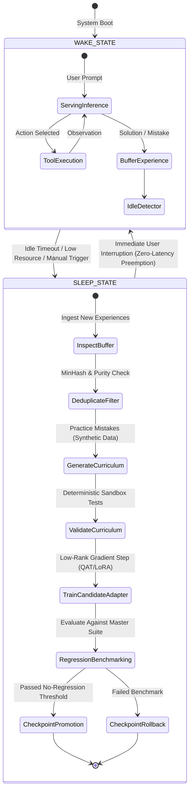

# HariAI — Unified Adaptive Intelligence Architecture (UAIA) & Dream Engine
**Specification Version:** `UAIA-Nano-1.0`  
**Target Checkpoint:** `HariAI Nano`  
**Weight Budget:** $\le 50.00\text{ MB}$  
**Continual Learning Engine:** `HariAI Dream Engine v1.0`

---

## 1. High-Level Architectural Diagram

```
+-----------------------------------------------------------------------------------------+
|                                    USER INPUT TOKENS                                    |
+-----------------------------------------------------------------------------------------+
                                             |
                                             v
+-----------------------------------------------------------------------------------------+
|                   TIED INPUT/OUTPUT EMBEDDINGS (Vocab V=4,096, d=512)                   |
|                   Storage: 4,096 x 512 = 2,097,152 params (~1.05 MB @ INT4)            |
+-----------------------------------------------------------------------------------------+
                                             |
                                             v
+-----------------------------------------------------------------------------------------+
|                              16 x UAIA-NANO TRANSFORMER BLOCKS                          |
|  +-----------------------------------------------------------------------------------+  |
|  | Input Hidden State h_l                                                            |  |
|  |       |                                                                           |  |
|  |       +---> [RMSNorm] ---> [Grouped-Query Latent Attention (GQLA)]                |  |
|  |       |                     - 8 Query Heads (dim 64), 2 KV Heads (GQA 4:1)        |  |
|  |       |                     - Rotary Position Embedding (RoPE)                    |  |
|  |       |                     - Causal Masking                                      |  |
|  |       +----------------(+) <------------------------------------------------------+  |
|  |                         |                                                         |  |
|  |                         +---> [RMSNorm] ---> [SwiGLU FFN (dim 512 -> 1376 -> 512)]|  |
|  |                         |                     w_gate, w_up, w_down                |  |
|  |                         +----------------(+) <------------------------------------+  |
|  |                                           |                                          |  |
|  |                                  Output h_{l+1}                                   |  |
|  +-----------------------------------------------------------------------------------+  |
+-----------------------------------------------------------------------------------------+
                                             |
                                             v
+-----------------------------------------------------------------------------------------+
|                                    FINAL RMSNORM                                        |
+-----------------------------------------------------------------------------------------+
                      |                                                   |
                      v                                                   v
+-------------------------------------------+   +-----------------------------------------+
|             LANGUAGE HEAD                 |   |       STRUCTURED DECISION HEAD          |
| Linear Projection using Tied Embeddings   |   | Linear Layer: R^512 -> R^32 Action Logits|
| Softmax -> Next Token Logits (V=4,096)    |   | + Calibrated Confidence Head: R^512 -> R|
+-------------------------------------------+   +-----------------------------------------+
```

---

## 2. Hierarchical Memory Architecture (Levels 1 to 5)

HariAI decouples memory across 5 explicit tiers to balance immediate latency with lifelong adaptability:

```
+-----------------------------------------------------------------------------------------+
| Level 1: WORKING MEMORY                                                                 |
| Current conversation window, transient KV-cache, scratchpad reasoning buffers           |
| Persistence: In-memory (RAM) ephemeral. Cleared on session termination.                 |
+-----------------------------------------------------------------------------------------+
                                             |  (Selective capture)
                                             v
+-----------------------------------------------------------------------------------------+
| Level 2: EPISODIC MEMORY                                                                |
| Interaction histories, successful trajectories, user corrections, tool error logs       |
| Persistence: Local append-only JSONL / SQLite database with timestamps and task IDs.     |
+-----------------------------------------------------------------------------------------+
                                             |  (Sleep-time consolidation)
                                             v
+-----------------------------------------------------------------------------------------+
| Level 3: SEMANTIC MEMORY                                                                |
| Deduplicated facts, conceptual knowledge graph, entity associations                     |
| Persistence: Embedded vector index (cosine similarity over learned representations).    |
+-----------------------------------------------------------------------------------------+
                                             |  (Algorithmic abstraction)
                                             v
+-----------------------------------------------------------------------------------------+
| Level 4: PROCEDURAL MEMORY                                                              |
| Executable code patterns, multi-step tool recipes, API schemas, decision policies       |
| Persistence: Versioned structured templates and rule graphs with verification hashes.   |
+-----------------------------------------------------------------------------------------+
                                             |  (Sleep-time distillation & fine-tuning)
                                             v
+-----------------------------------------------------------------------------------------+
| Level 5: PARAMETRIC MEMORY                                                              |
| Base model weights (protected) + Modular Low-Rank Specialist Adapters (trainable)       |
| Persistence: Binary weight checkpoints (<50 MB base + dynamic LoRA delta matrices).     |
+-----------------------------------------------------------------------------------------+
```

---

## 3. HariAI Dream Engine: Wake/Sleep Lifecycle Specification



### 3.1 Operating States
1. **Wake State (Active Intelligence):**
   - Serves interactive user prompts, performs multi-step reasoning, executes authorized local tools.
   - Operates with strict zero-training overhead: no backward pass or gradient computations during interactive inference.
   - Non-blocking logging of execution traces, successful solutions, and user corrections into Level 2 Episodic Memory.

2. **Sleep State (Offline Continual Learning):**
   - Automatically engaged when the host system is idle, plugged into AC power (on laptops), or triggered via `hari dream now`.
   - Preemptible within $\le 50\text{ ms}$: Any new user input instantly pauses or aborts sleep compute to restore full interactive responsiveness.
   - Consolidates episodic traces into semantic knowledge and procedural recipes.
   - Synthesizes practice problems targeted specifically at recent failures (e.g. syntax errors or logic bugs).
   - Generates candidate adapter weights $\Delta \mathbf{W}$, tests them against the permanent regression suite, and either promotes or rolls back the candidate.

---

## 4. Preventing Catastrophic Forgetting: Modular Parameter Updates

To guarantee that new learning never degrades existing capabilities:
1. **Base Weight Freezing:** The core 46.4M parameter weights $\mathbf{W}_0$ remain strictly read-only after base pre-training.
2. **Modular Low-Rank Adaptation (LoRA / Specialist Adapters):** Continual parameter learning operates via low-rank decomposition matrices:
   $$\mathbf{W} = \mathbf{W}_0 + \frac{\alpha}{r} (\mathbf{B} \mathbf{A})$$
   where $r \in \{4, 8\}$ and $\mathbf{B} \in \mathbb{R}^{d \times r}, \mathbf{A} \in \mathbb{R}^{r \times d}$.
   - An adapter matrix for 16 layers with $r=4$ requires only $\approx 0.5\text{ MB}$ of storage!
3. **Permanent Regression Harness:** A fixed suite of 250 diverse benchmark problems (math, coding, reasoning, safety, creator identity) is evaluated before and after any sleep cycle. If regression $> 1.0\%$ on any core metric, the candidate checkpoint is automatically rejected and rolled back.

---

## 5. Mathematical Formalization of Core Model

### 5.1 Embedding & Weight Tying
Let $V = 4,096$ be vocabulary size and $d = 512$ be hidden dimension.
$$\mathbf{E} \in \mathbb{R}^{V \times d}$$
$$\mathbf{x}_t = \mathbf{E}_{w_t}$$
The final language modeling head reuses $\mathbf{E}^T$ directly:
$$\mathbf{y}_{\text{LM}} = \mathbf{h}_{\text{final}} \mathbf{E}^T \in \mathbb{R}^{V}$$

### 5.2 Root Mean Square Normalization (RMSNorm)
For vector $\mathbf{x} \in \mathbb{R}^d$:
$$\text{RMS}(\mathbf{x}) = \sqrt{\frac{1}{d} \sum_{i=1}^d x_i^2 + \epsilon}$$
$$\text{RMSNorm}(\mathbf{x}) = \frac{\mathbf{x}}{\text{RMS}(\mathbf{x})} \odot \mathbf{g}$$
where $\mathbf{g} \in \mathbb{R}^d$ is a learnable scaling parameter and $\epsilon = 10^{-5}$.

### 5.3 Rotary Position Embedding (RoPE)
Given query $\mathbf{q}$ and key $\mathbf{k}$ at token position $m \in \{0, \dots, T-1\}$:
$$\mathbf{R}_{\Theta, m}^d = \text{diag}\left(\mathbf{R}_{\theta_1, m}, \dots, \mathbf{R}_{\theta_{d/2}, m}\right)$$
$$\theta_i = 10000^{-2(i-1)/d}$$
$$\tilde{\mathbf{q}}_m = \mathbf{R}_{\Theta, m}^d \mathbf{q}_m, \quad \tilde{\mathbf{k}}_m = \mathbf{R}_{\Theta, m}^d \mathbf{k}_m$$

### 5.4 Grouped-Query Latent Attention (GQLA)
- Query heads: $H_Q = 8$
- Key/Value heads: $H_{KV} = 2$
- Group ratio: $G = H_Q / H_{KV} = 4$
- Head dimension: $d_k = d / H_Q = 512 / 8 = 64$

### 5.5 SwiGLU Feed-Forward Network
Given intermediate dimension $d_{ff} = 1,376$:
$$\text{FFN}(\mathbf{x}) = \left(\text{Swish}(\mathbf{x} \mathbf{W}_{\text{gate}}) \odot (\mathbf{x} \mathbf{W}_{\text{up}})\right) \mathbf{W}_{\text{down}}$$
where $\mathbf{W}_{\text{gate}}, \mathbf{W}_{\text{up}} \in \mathbb{R}^{d \times d_{ff}}$, and $\mathbf{W}_{\text{down}} \in \mathbb{R}^{d_{ff} \times d}$.

### 5.6 Dual-Head Language & Decision Interface
At sequence position $t$, the final hidden vector $\mathbf{h}_t \in \mathbb{R}^{512}$ feeds two heads:
1. **Next-Token Head:** $\mathbf{P}(w_{t+1}) = \text{Softmax}(\mathbf{h}_t \mathbf{E}^T)$
2. **Action Decision Head:**
   $$\mathbf{a}_t = \text{Softmax}(\mathbf{h}_t \mathbf{W}_{\text{action}}), \quad \mathbf{W}_{\text{action}} \in \mathbb{R}^{512 \times 32}$$
   $$c_t = \sigma(\mathbf{h}_t \mathbf{w}_{\text{conf}}), \quad \mathbf{w}_{\text{conf}} \in \mathbb{R}^{512 \times 1}$$

---

## 6. Parameter and Size Budget Specification

| Component | Dimensions | Parameter Count | Size at FP16 | Size at INT4 (0.56 B/p) |
|---|---|---|---|---|
| Tied Embedding / LM Head | $4,096 \times 512$ | $2,097,152$ | $4.19\text{ MB}$ | $1.17\text{ MB}$ |
| Attention $W_q, W_k, W_v, W_o$ (16 layers) | $16 \times (512 \times 512 + 2 \times 512 \times 128 + 512 \times 512)$ | $10,485,760$ | $20.97\text{ MB}$ | $5.87\text{ MB}$ |
| SwiGLU FFN $W_{\text{gate}}, W_{\text{up}}, W_{\text{down}}$ (16 layers) | $16 \times (3 \times 512 \times 1376)$ | $33,816,576$ | $67.63\text{ MB}$ | $18.94\text{ MB}$ |
| Normalization Gains (33 RMSNorms) | $33 \times 512$ | $16,896$ | $0.03\text{ MB}$ | $0.03\text{ MB}$ |
| Action & Confidence Decision Head | $512 \times 32 + 512 \times 1$ | $16,896$ | $0.03\text{ MB}$ | $0.01\text{ MB}$ |
| Modular Specialist LoRA Delta ($r=4$) | $16 \times 2 \times (512 \times 4 + 4 \times 512)$ | $131,072$ | $0.26\text{ MB}$ | $0.07\text{ MB}$ |
| **Total Base Weights + Adapter** | — | **46,564,352** | **93.11 MB** | **26.09 MB** |

> **Size Feasibility:** Total weights remain at **$\approx 26.1\text{ MB}$** at INT4, giving **$23.9\text{ MB}$ of remaining budget** under the $50\text{ MB}$ ceiling for future specialist adapters.
