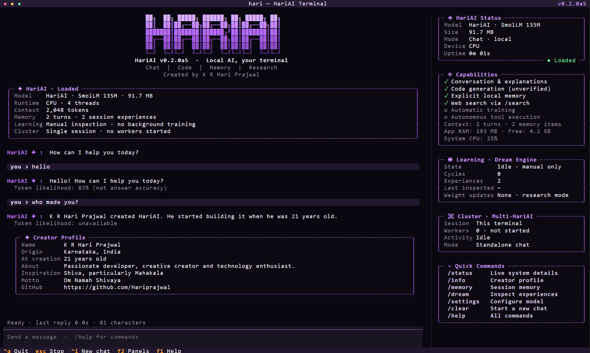

# HariAI

**Local AI by K R Hari Prajwal — a standalone language model and experimental typed decisions.**


[](https://www.python.org/)
[](LICENSE)
[](docs/research/STANDALONE_MODEL_PLAN.md)

HariAI runs a local GGUF model directly in Python. On the development machine,
the model file is already available and chat needs no Ollama service or network.
The model-bearing release wheel has **not** been published or approved: the
current models failed quality checks and model files are excluded from Git.

The language model is derived from **Hugging Face SmolLM-135M-Instruct**. HariAI's
adaptation, runtime and packaging are by **K R Hari Prajwal**. Upstream model
credit and licensing are preserved. This is an experimental small assistant,
not a ChatGPT-equivalent foundation model trained from scratch.

## Start chatting

Requires Python 3.10+ and the native `llama-cpp-python` runtime. The development checkout can use an existing compatible model file:

```powershell
python -m pip install -e .
python -m hari_ai.cli ask "Hello!"
python -m hari_ai.cli
```

After changing the local code, enter `/exit` and start the app again. Enter
`/version` inside chat to check the running app version. The version number is
for the application; it does not imply that a new language model was trained.

`hari`, `hari run`, and `python -m hari_ai.cli` open the purple **live terminal
dashboard** in an interactive terminal. It includes streaming chat, grey token
likelihood beneath replies, a creator profile, and live panels for runtime,
capabilities, Dream inspection, cluster state, Mahakaal artwork, and commands.



The screenshot is a real local session; its model size and telemetry are sampled,
not example targets. Model availability, device, uptime, CPU/RAM, conversation
counts, reply activity, and Dream inspection counts update from runtime state.
The idle Dream worker starts with the terminal and consolidates new session
experiences after inactivity. It does not train model weights. Desktop and
MCP tool actions start only after you give an explicit task.

Maximize the terminal for the two-column layout (112 columns or more). On narrow
windows, **F2** switches between chat and the panels. **Esc** stops a streaming
reply; **Ctrl+L** starts a new chat; **Ctrl+Q** quits; **Up/Down** recall input.
The Mahakaal panel uses a high-density, colour-preserving Braille rendering of
the packaged artwork. This avoids terminal graphics protocols that can leave
stale rows in a live Textual screen while preserving more detail than enlarged
half-cell colour blocks.
Use `/info` for the creator card, `/settings show` for configuration, and `/help`
for commands. Existing commands remain available inside the dashboard.
`hari run --plain` keeps the line-based interface; redirected input/output use it
automatically. `NO_COLOR` is respected. Restart existing sessions to load v0.2.0a5.

No wheel or model is published yet. A fresh clone requires a compatible ChatML
GGUF file configured with `hari settings model-file PATH`; Git does not include it.
For the development checkout with the local model present:

```bash
python -m pip install -e .
python -m hari_ai.cli ask "Explain a Python list"
```

If compiling the native runtime is inconvenient, its maintainers document
[CPU wheels](https://github.com/abetlen/llama-cpp-python#installation):

```bash
python -m pip install llama-cpp-python --extra-index-url https://abetlen.github.io/llama-cpp-python/whl/cpu
```

Large model files are excluded from normal Git commits. A plain source clone
needs a release model or an explicitly configured compatible ChatML GGUF:

```bash
hari settings model-file /path/to/hariai-chat.gguf
hari settings backend local
```

## What is included

| Component | Purpose | Current limit |
| --- | --- | --- |
| Local language model | Experimental conversation | About 92 MB; failed basic arithmetic, factual and coding checks |
| Open-JEV reference | Typed decision architecture, packaged with attribution | Not TypeSafe AI's production Jev model |
| Operation-policy experiment | A small trained Open-JEV classifier for a fixed JSON schema | Checkpoint is local and excluded from Git; advisory only |
| Memory and Dream | Explicit saved memory plus automatic idle consolidation of new session experiences | No automatic model weight updates or production checkpoint promotion |
| Autonomous desktop | Local vision model, selected screen region, bounded actions, Pause/Take over | Requires Ollama with an installed local vision model; model completion still needs human review |
| MCP tools | Local model plans calls to built-in tools and explicitly configured MCP servers | Tool planning requires the local GGUF backend and stops on invalid plans or arguments |
| Original Nano | Archived research implementation, explicitly selectable | Failed general-chat probes; no longer the default |

The original 35 MB target is **not met** by the chat model. File size, installed
Python dependencies, and peak memory are different measurements. See the
[standalone model research](docs/research/STANDALONE_MODEL_PLAN.md) and the
[live conversation report](docs/research/LIVE_CHAT_EVALUATION.md) for actual responses.

The original README from `master` is preserved as [a historical document](docs/MASTER_README_HISTORICAL.md). It contains outdated capability claims; this README records the current results.

## Python API

```python
from hari_ai import HariAI

ai = HariAI()  # Requires a local GGUF file; no Ollama service
print(ai.ask("Explain recursion in two sentences."))
print(ai.ask("Give a small example."))  # Retains this session's context

# Requires the locally trained operation checkpoint, which is not in Git.
# This separate, bounded typed-decision task never performs the operation.
result = ai.decide_operation({
    "operation": "delete",
    "scope": "all",
    "authorized": "yes",
    "backup": "no",
})
print(result)
```

The operation model accepts `read`, `list`, `create`, `update`, `delete`,
`format`, `overwrite`, or `export`; `scope` is `single`, `batch`, or `all`;
`authorized` and `backup` are `yes` or `no`. It returns a choice from `proceed`,
`review`, and `stop`. Its probabilities are not calibrated correctness scores.
Use actual program permissions to control actions. General `decide` calls need
a separately trained checkpoint matching the intended task.

## Settings and local memory

The default backend is `local`. An existing Ollama installation remains optional:

```bash
hari settings show
hari settings list-models
hari settings ollama-model your-installed-model
hari settings backend ollama
hari settings backend local
hari memory add "I prefer concise explanations"
hari memory inspect
hari memory delete 1
```

Settings and saved memories live in `~/.hari_ai`, or `HARIAI_DATA_DIR` when set.
Chat history is held in the session. Saved memories are plaintext and are not
fed into training automatically. The separate `search` command uses the network;
ordinary local chat does not.

## Autonomous tasks and MCP tools

The terminal has two task runners. MCP tasks use the local HariAI text model to
choose from registered tools and pass validated JSON arguments. To add an MCP
stdio server, configure it and start a task:

```bash
hari mcp add SERVER_NAME COMMAND ARGUMENTS...
hari mcp connect
hari tools
hari tools run "Search for the document and convert it to Markdown"
```

The in-chat form is `/tools run <task>`. It makes at most five tool calls, checks
arguments against the advertised schema, and stops on malformed plans, errors,
or Escape. This planning path requires the local GGUF chat backend; tool
descriptions and results do not switch to an online model. Only built-ins and
MCP servers you configured are offered to the planner.

Desktop control is separate because the small chat model cannot read pixels.
Install the optional desktop dependencies, run HariAI, choose a locally
installed vision model, and select the exact screen region before starting:

```bash
python -m pip install -e ".[desktop]"
hari run
```

Then enter `/agent model <installed-vision-model>`, `/agent select`, and
`/auto <desktop task>`. The controller checks Ollama's `/api/show` response for
the `vision` capability before it captures a screenshot, and sends that image
only to the configured loopback service using Ollama's image input API. It
observes after each action and stops after eight actions. Pause, Take over, or
Escape stops the loop; an in-flight local inference may return before the stop
is acknowledged, and no later action is applied. A “model reports complete”
message is a request to review the target application, not proof of success.
See [Ollama's vision API guide](https://github.com/ollama/ollama/blob/main/docs/capabilities/vision.mdx).
The recommended accessibility/OCR/vision layering is described in
[`docs/research/DESKTOP_PERCEPTION.md`](docs/research/DESKTOP_PERCEPTION.md).

The CLI shows the **average base-model token likelihood** after local
model-generated replies. For example, `Token likelihood: 83%` means the model assigned its generated tokens an average probability
of 83% before sampling adjustments. This is a language-prediction signal, not
a calibrated probability that the answer is correct. The line is grey in an
interactive terminal. Hard-coded replies or unsupported runtimes show
`Token likelihood: unavailable`. The lightweight observer is currently checked
against `llama-cpp-python` 0.3.8; other versions still run chat but omit this
score until their sampling interface is verified. Use
`hari settings confidence off` to hide it or `hari settings confidence on` to
show it again. See [confidence research](docs/research/CHAT_CONFIDENCE.md) and
the [calibration system design](docs/research/CALIBRATED_CONFIDENCE_DESIGN.md).
The [independent-model rebuild audit](docs/research/REBUILD_AUDIT_2026_11.md)
separates the current SmolLM-derived chat baseline from scratch-training work.
Run `hari status` or `/status` to see the active backend, model file and the
actual state of the experimental learning and cluster features.
Use `hari settings confidence-status` to see the current confidence coverage.
For a complete, single-turn integer arithmetic question and an unambiguous
number or matching equation, HariAI checks the calculation directly and shows either
`100% (verified arithmetic)` or `0% (verified arithmetic)`. This is an exact
check of that restricted answer, not the language model's self-confidence;
when available, the separate token-likelihood line is shown as well.
General-chat confidence has not been validated and remains unavailable.
For an underspecified request such as “give me the C program”, HariAI asks what
the program should do. The local language model can still generate invalid code.

## Reproduce and evaluate

```bash
python -m unittest discover tests
python scripts/adapt_smollm.py --base /path/to/original-smollm.gguf --output checkpoints/my-candidate --steps 300
python scripts/train_operation_jev.py
python scripts/assemble_release.py /path/to/passing-candidate --fresh-report /path/to/report.json
python scripts/build_release.py
```

Training is offline once the base file and dependencies are installed. Candidate
scripts write separate checkpoints and reports. They do not replace the active
model. Small development probes are not evidence of general benchmark accuracy.
Candidates must pass release gates, and model files must match their manifest hashes before building. No candidate has passed these gates yet.

The new model work supersedes earlier claims about a verified general assistant
under 35/45 MB. Historical experiments are retained in [BENCHMARKS.md](BENCHMARKS.md)
and [Dream research status](docs/research/DREAM_ENGINE_STATUS.md).

## Attribution and license

Created and maintained by [K R Hari Prajwal](https://github.com/Hariprajwal).
HariAI software and HariAI-specific modifications use the
[HariAI Noncommercial License](LICENSE). Commercial use of those portions
requires a separate written agreement with the creator.

SmolLM's upstream weights and the vendored Open-JEV implementation retain their
Apache 2.0 terms. See [third-party notices](THIRD_PARTY_NOTICES.md), the bundled
model license, and [data provenance](DATA_LICENSES.md). The HariAI commercial
restriction does not revoke upstream rights or earlier Apache grants. This
project is source-available, not OSI open source.

Report problems through [GitHub Issues](https://github.com/Hariprajwal/HariAI/issues),
including package version, platform, model hash and a reproducible prompt.
