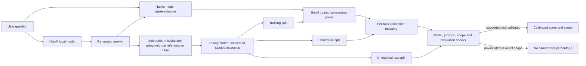

# HariAI calibrated confidence system design

## What the number means

For a supported task and a stated grading rubric, a score of 70% should mean
that about 70% of similarly scored HariAI responses meet that rubric, measured
on previously unseen, independently graded examples. Calibration is a
population property; no finite test proves that a particular answer is correct
or guarantees accuracy on different users, models, topics, or prompt styles.
Factual correctness is not a well-defined target for a greeting or a creative
request; those require a separate, explicitly specified quality rubric and data.

## Proposed architecture

1. **Model evidence:** extract representations from the exact model and the
   actual answer, using a versioned formatting and tokenization protocol. A
   small linear or nonlinear head can score correctness without a second model
   file. A separate model context or another forward pass may be required for
   the current GGUF runtime; actual memory and latency must be measured.
2. **Independent labels:** grade model-generated answers against executable
   tests, trusted answer keys, or independently reviewed rubrics. Keep
   incomplete and ambiguous answers separate; do not silently label them wrong.
   A language-model judge supplies fallible pseudo-labels, not ground truth.
3. **Partition:** group related questions before assigning train, calibration,
   and final test sets. Near-duplicates, paraphrases, related source documents,
   and repeated user tasks must not cross splits. Freeze the test before model
   selection, and get a fresh test after tuning against an earlier one.
4. **Train and calibrate:** train the probe on training answers only, select its
   architecture on development data, then fit a low-parameter Platt or
   temperature mapping on independent calibration answers. A model's own
   token likelihood, self-judgment, or semantic consistency is a feature, not
   automatically a probability that its answer is correct.
5. **Release gate:** evaluate both outcomes and calibration on the untouched
   test. Record counts, label balance, coverage, Brier score, calibration
   error, ranking performance, reliability bins, and uncertainty intervals.
   Compare with the constant base-rate baseline. Report per-domain and
   out-of-distribution results; insufficient data or a failed check prevents
   numerical correctness scores in that scope. Passing is evidence for the
   evaluated distribution, not a universal or perfect-calibration guarantee.
   The current evaluator also computes a paired 95% bootstrap interval for
   the Brier improvement and rejects a candidate if that interval includes zero
   or worse. This interval holds the fitted mapping and baseline fixed and does
   not account for calibration-training uncertainty or non-independent groups.
   It also reports Wilson intervals for the observed accuracy of each
   reliability bin; these assume independent, representative examples and
   show how little can be concluded from a sparsely populated bin.
6. **Deploy and monitor:** bind the result to model and probe hashes, system
   prompt, generation settings, task format, label definition and data version.
   Reassess on model or distribution changes. User conversations must not be
   stored or used as labels automatically; any feedback collection needs an
   explicit privacy design and a way to delete data.

## Experiments in this repository

The current runtime has an exact checker for a limited integer-arithmetic task;
its 0% or 100% output is a deterministic verdict, not a trained confidence
model. General-chat answer correctness is not calibrated.

The following new development-only experiment used HariAI's model and 300
distinct ARC-Easy multiple-choice questions, with the model constrained to make
a letter decision from its own next-token logits. This protocol is not normal
free-form chat. Original answer keys supply labels, and no additional model is
needed for inference. The dataset has its own CC BY-SA 4.0 terms and is not
packaged with HariAI. The calibration and final test partitions were not used.
Whether the original base model encountered these questions during pretraining
is unknown, so the splits are unseen by this probe, not proven unseen by SmolLM.

* The uncorrected model picked the first answer on **291/300** questions. It got
  **62/300** decisions right. Raw confidence had Brier **0.584**, ten-bin ECE
  **0.638**, and AUROC **0.492**: its score did not meaningfully rank correct
  versus wrong decisions.
* Averaging across four cyclic option positions on the first 100 development
  questions reduced the raw ECE to **0.085** but AUROC was **0.542** and Brier
  **0.156**, worse than a constant 18% rate on that same sample (**0.148**).
  Lower ECE alone can therefore mask an uninformative score.
* A regularized linear probe on frozen HariAI mean and last-token features,
  trained on 200 development questions and evaluated on 100 different ones,
  reached validation AUROC between **0.456 and 0.494** for the tried
  regularization values. The best validation Brier was **0.171**, versus about
  **0.160** for the constant training-base-rate prediction. These development
  samples are small; their role is to reject weak candidates, not establish
  general performance.
* On a separate development experiment using **actual generated arithmetic
  answers**, a similar native probe trained on 155 answers and evaluated on 155
  previously explored answers obtained AUROC **0.613–0.675** across four
  regularization values. Its best Brier was **0.0609** versus **0.0661** for
  the constant training-rate baseline. However, the two groups contained only
  **9 and 11 correct answers**, respectively, and the evaluation questions
  were already inspected. For the candidate with best Brier, the paired
  bootstrap interval for improvement over the constant baseline was
  **-0.0048 to 0.0195**, including zero; all four intervals included zero.
  The intervals hold the trained model and baseline fixed and do not correct
  for trying multiple candidates on this development set. This is a possible
  direction to investigate, not independent
  evidence of calibrated general-chat confidence. The experiment can be
  reproduced with `scripts/research_arithmetic_native_probe.py` using the
  locally saved data.

No candidate was installed. The arithmetic probe lacks enough positive outcomes
and a fresh evaluation; the multiple-choice probe failed development screening,
so its reserved calibration and test sets were not consumed. The choice
experiment is reproducible with `scripts/research_native_choice.py` and
`scripts/research_choice_probe.py`; generated local artifacts are Git-ignored.

## Research basis

* [Language Models (Mostly) Know What They Know](https://arxiv.org/abs/2207.05221)
  studies model self-evaluation; it does not guarantee reliable self-assessment
  for HariAI's model.
* [Large Language Models Must Be Taught to Know What They Don't Know](https://arxiv.org/abs/2406.08391)
  studies supervised uncertainty estimation using graded outputs.
* [Semantic Entropy Probes](https://arxiv.org/abs/2406.15927) investigate a
  learned internal-representation signal for semantic uncertainty; uncertainty
  and answer correctness are distinct targets.
* [CALIBER](https://arxiv.org/abs/2606.24281) distinguishes the probability of
  solving a prompt from the correctness of a particular generated answer.
